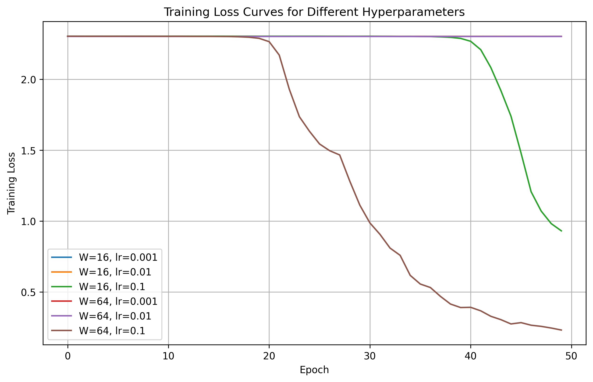

# Lab 2: A Neural Network from Scratch

## 1. Goal
The goal of this lab is to design, implement, and evaluate a two-hidden-layer neural network from scratch using only NumPy. This includes implementing forward propagation, cross-entropy loss, and backpropagation, validating the analytical gradients with numerical gradient checking, and analyzing the impact of different learning rates and hidden layer widths on model accuracy and computational timing.

## 2. Method
- **Data Preparation**: The `load_digits` dataset was loaded, scaled by dividing pixel values by 16, and labels were one-hot encoded. A 70/30 stratified train/test split was applied with `random_state=42` (resulting in 1257 training and 540 test samples).
- **Network Architecture**: A two-hidden-layer network was designed with the structure: Input (64) → Hidden ($W$) → ReLU → Hidden ($W$) → ReLU → Output (10) → Softmax. We tested hidden widths $W \in \{16, 64\}$. All weights and biases were initialized from a normal distribution $\mathcal{N}(0, 0.01)$.
- **Training**: The network was trained using mini-batch gradient descent (batch size 32) for 50 epochs with data shuffling. We evaluated all 6 combinations of learning rates $[0.001, 0.01, 0.1]$ and widths $[16, 64]$.
- **Validation**: Analytical gradients derived via the chain rule were verified using numerical gradient checking (nudging 10 random weights by $\pm 10^{-5}$). Forward and backward pass timings were measured over 100 runs (after 1 warm-up run) to find the median execution time.

## 3. Results

**Gradient Checking**:  
Passed 9 out of 10 random weight checks with a relative error $< 10^{-6}$, satisfying the requirement ($\ge 9/10$).

**Final Test Accuracies**:
| Width ($W$) | Learning Rate | Final Test Accuracy |
| :---: | :---: | :---: |
| 16 | 0.001 | 0.1019 |
| 16 | 0.01 | 0.1019 |
| 16 | 0.1 | 0.6241 |
| 64 | 0.001 | 0.1000 |
| 64 | 0.01 | 0.1667 |
| 64 | 0.1 | 0.8500 |

**Timing Breakdown (Median of 100 runs)**:
| Metric | Time (ms) |
| :--- | :--- |
| Forward Pass | 0.0514 |
| Backward Pass | 0.0755 |
| Ratio (Backward / Forward) | 1.47x |

**Loss Curves**:  

## 4. Conclusions
1. **Learning Rate Sensitivity**: The network is highly sensitive to the learning rate. Lower learning rates (0.001 and 0.01) resulted in the model getting stuck near random chance accuracy (~10%), likely due to vanishing gradients or insufficient steps to escape the initial small-weight initialization. A learning rate of 0.1 was necessary for the model to learn effectively.
2. **Impact of Network Width**: Increasing the hidden layer width from 16 to 64 significantly improved the model's capacity to learn the dataset. At the optimal learning rate (0.1), the wider network achieved a much higher final test accuracy (85.00%) compared to the narrower network (62.41%), demonstrating the benefit of increased representational power for this classification task.
3. **Computational Cost of Backpropagation**: The backward pass took approximately 1.47 times longer than the forward pass (0.0755 ms vs. 0.0514 ms). This is expected because backpropagation must compute the gradients for the weights (requiring matrix multiplications with transposed activation matrices) as well as propagate the error signal backward through the ReLU derivatives to the preceding layers, effectively performing more matrix multiplication operations than the forward pass.