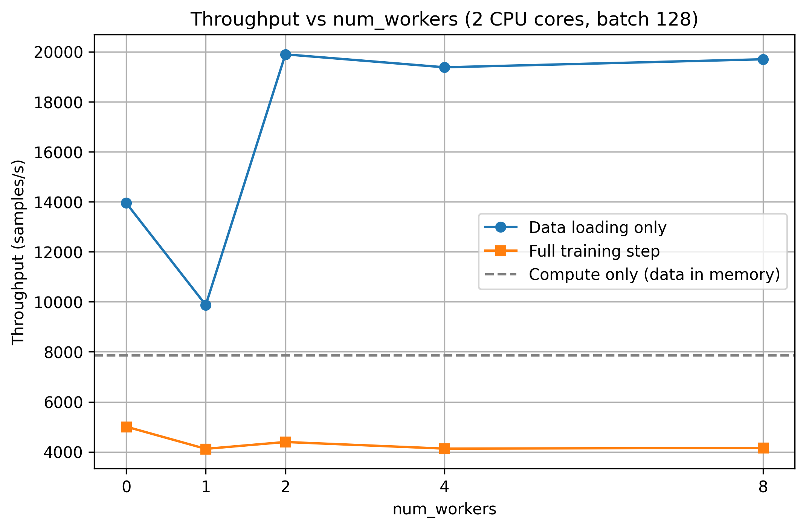
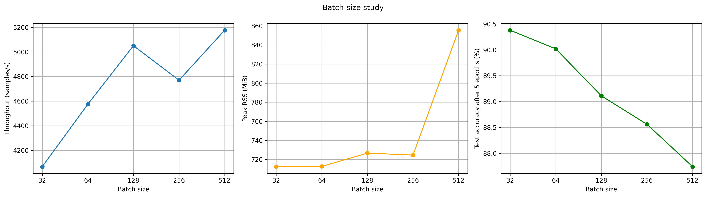
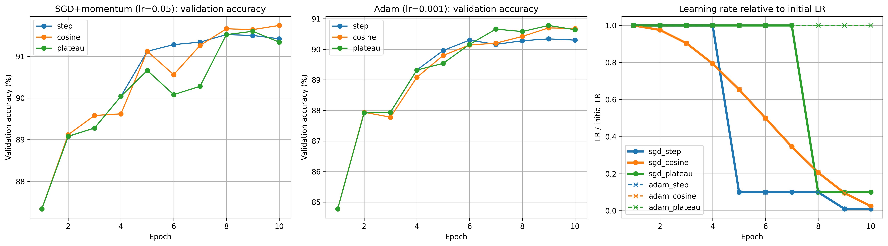
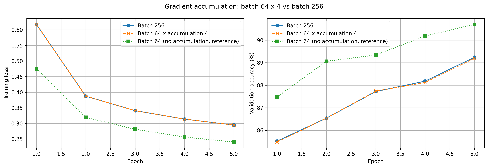
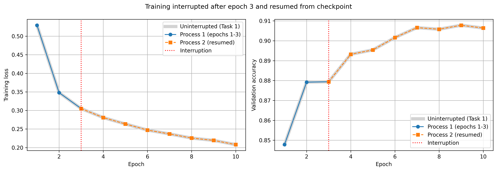

# Lab 6: Training Pipelines and Project Proposal

## 1. Goal
The goal of this lab is to turn the best model from Lab 3 (SimpleCNN on Fashion-MNIST, 88.61% test accuracy) into a reproducible, YAML-driven training pipeline with checkpointing and MLflow experiment tracking, and then use it to profile training, find the data-loading bottleneck, and study batch size, optimizers, learning-rate schedules, gradient accumulation and recovery from an interruption. The lab ends with a one-page individual project proposal (`proposal.md`).

## 2. Method
- **Pipeline** (`src/train_pipeline.py`, `src/config.yaml`): One YAML file is loaded into a single config object that controls the seed, data (batch size, `num_workers`, 55k/5k train/validation split as in Lab 3), model, optimizer, scheduler, gradient accumulation, checkpointing and MLflow. After every epoch a checkpoint stores the model, optimizer and scheduler states, the RNG states, the history and the MLflow run id. The shuffle order depends only on (seed, epoch), so a resumed run sees exactly the same batches. Every run logs its params, per-epoch metrics (loss, accuracy, LR, epoch time, throughput) and artifacts (config, history, checkpoint) to a local MLflow store (`lab06/mlruns/`, viewed with `mlflow ui --backend-store-uri lab06/mlruns`; not committed, it is recreated by running the scripts). Checkpoints are written to `lab06/results/checkpoints/` and are not committed either. The studies reuse the same pipeline with config overrides, so every study run is also an MLflow run.
- **Profiling** (`src/task2_profile.py`): One full epoch (430 batches of 128, `num_workers=0`) is profiled with `torch.profiler`, with `record_function` labels for data loading, forward pass, backward pass and optimizer step. Profiling the whole epoch at once ran out of memory (the per-image transforms create over a million events), so the epoch was profiled in 10 consecutive chunks of 43 steps whose totals were added up. Wall-clock timers around the same phases were used as a cross-check.
- **num_workers** (`src/task3_num_workers.py`): For `num_workers` in [0, 1, 2, 4, 8], one epoch was measured twice: loading data only (no model) and full training. A compute-only run on batches already in memory gives the upper limit without any data loading.
- **Batch size** (`src/task4_batch_size.py`): Batch sizes [32, 64, 128, 256, 512] were trained for 5 epochs each with Adam (lr = 0.001). Each batch size runs in its own process, so its peak resident memory (RSS) is measured on its own.
- **Schedules and optimizers** (`src/task5_schedulers_optimizers.py`): StepLR (step 4, γ = 0.1), CosineAnnealingLR (T_max = 10) and ReduceLROnPlateau (on validation accuracy, factor 0.1, patience 1) were each combined with SGD+momentum (lr = 0.05, momentum = 0.9) and Adam (lr = 0.001), for a fixed budget of 10 epochs per run.
- **Gradient accumulation** (`src/task6_grad_accumulation.py`): Micro-batches of 64 with 4 accumulation steps (effective batch 256) were compared with a real batch of 256 and with plain batch 64, for 5 epochs each and with the same data order. A one-step check also compares the accumulated gradient with the batch-256 gradient on the same 256 samples.
- **Resume** (`src/task7_resume.py`): One process trains with the Task 1 config and exits after epoch 3; a second, new process loads the checkpoint and finishes epochs 4–10. The curves are compared with the uninterrupted Task 1 run.
- **Hardware**: CPU only, 2 cores, PyTorch 2.3.1, seed 42 everywhere.

## 3. Results

**Task 1: Pipeline run** (`results/pipeline_run.txt`, MLflow experiment `lab06_pipeline`):
SimpleCNN, Adam lr = 0.001, batch 128, 10 epochs: **90.10% test accuracy** (Lab 3, 5 epochs: 88.61%). Final validation accuracy 90.64%; about 11.4 s and 4,800 samples/s per epoch.

**Task 2: Profile of one epoch** (`results/profile_breakdown.txt`):
| Phase | Time (ms) | Share of epoch |
| :--- | :---: | :---: |
| Data loading | 5732.6 | 44.6% |
| Forward pass | 4191.6 | 32.6% |
| Backward pass | 2682.4 | 20.9% |
| Optimizer step | 246.2 | 1.9% |

The single most expensive item in the profile is the DataLoader iteration itself (34.3% of self CPU time), followed by `max_pool2d` (20.4%) and the convolution backward pass (12.8%). The wall-clock timers agree with the profiler to within 0.1 percentage points.

**Task 3: num_workers** (`results/num_workers_study.txt`, `results/num_workers_throughput.png`):
| num_workers | Loading only (samples/s) | Full training (samples/s) | Speed-up vs 0 |
| :---: | :---: | :---: | :---: |
| 0 | 13,950 | 5,007 | 1.00x |
| 1 | 9,871 | 4,120 | 0.82x |
| 2 | 19,894 | 4,394 | 0.88x |
| 4 | 19,376 | 4,129 | 0.82x |
| 8 | 19,697 | 4,158 | 0.83x |

Compute only (data already in memory): 7,855 samples/s.

**Task 4: Batch-size study, 5 epochs** (`results/batch_size_study.txt`, `results/batch_size_study.png`):
| Batch | Steps/epoch | Throughput (samples/s) | Peak RSS (MiB) | Memory added by training (MiB) | Test accuracy |
| :---: | :---: | :---: | :---: | :---: | :---: |
| 32 | 1719 | 4,067 | 712.5 | 94.9 | 90.38% |
| 64 | 860 | 4,576 | 712.7 | 95.0 | 90.02% |
| 128 | 430 | 5,051 | 726.7 | 109.1 | 89.11% |
| 256 | 215 | 4,771 | 724.6 | 107.3 | 88.56% |
| 512 | 108 | 5,177 | 855.4 | 237.8 | 87.74% |

**Task 5: Schedules and optimizers, 10 epochs each** (`results/schedulers_optimizers.txt`, `results/schedulers_optimizers.png`):
| Optimizer | Schedule | Final train loss | Best val acc | Test acc |
| :--- | :--- | :---: | :---: | :---: |
| SGD+momentum | StepLR | 0.1770 | 91.52% | **91.33%** |
| SGD+momentum | Cosine | 0.1573 | 91.74% | 91.19% |
| SGD+momentum | Plateau | 0.1603 | 91.60% | 91.28% |
| Adam | StepLR | 0.2310 | 90.34% | 89.72% |
| Adam | Cosine | 0.2141 | 90.70% | 90.15% |
| Adam | Plateau | 0.2080 | 90.78% | 90.10% |

**Task 6: Gradient accumulation, 5 epochs** (`results/grad_accumulation.txt`, `results/grad_accumulation.png`):
| Run | Optimizer steps/epoch | Final train loss | Final val acc | Test acc |
| :--- | :---: | :---: | :---: | :---: |
| Batch 256 | 215 | 0.2949 | 89.24% | 88.56% |
| Batch 64 × accumulation 4 | 215 | 0.2949 | 89.20% | 88.59% |
| Batch 64 (reference) | 860 | 0.2404 | 90.70% | 90.02% |

One-step gradient check on the same 256 samples: max abs difference 9.31e-08. Over 5 epochs, batch 256 and 64 × 4 differ by at most 5.57e-05 in training loss and 0.06 points in validation accuracy.

**Task 7: Interrupt at epoch 3 and resume** (`results/resume_from_checkpoint.txt`, `results/resume_from_checkpoint.png`):
The resumed run reproduces the uninterrupted Task 1 run exactly: the max abs difference is 0.00 in training loss and 0.0000 in validation accuracy at every epoch, and the final test accuracy is the same (90.10%). In MLflow the resumed epochs continue the same run (`cnn_resume`), so its curves are one continuous line.

**Task 8: Project proposal**: see `proposal.md`.

## 4. Conclusions
1. **Data loading is the bottleneck, and here it is limited by CPU cores, not by workers.** Data loading takes 44.6% of the epoch, the largest single phase and almost as much as the forward and backward passes together (53.5%), because every image is converted and normalised in Python on every epoch. Adding workers made loading alone faster (13,950 → 19,894 samples/s at 2 workers) but made training slower (by 12–18%): this machine has only 2 cores, and the worker processes compete with the 2 compute threads of the forward and backward passes. The compute-only ceiling of 7,855 samples/s shows that removing the loading cost would give about 1.6x. On a machine with spare cores, 2–4 workers would hide the loading time; here the better fix is to pre-process the dataset once into a tensor in memory.
2. **Larger batches are faster per sample but learn less in a fixed number of epochs.** Throughput rose from 4,067 samples/s (batch 32) to about 5,050 samples/s at batch 128 and then levelled off (4,771–5,177 samples/s for 256–512, within run-to-run noise), because per-batch overhead stops mattering once the batch is large. Memory stayed nearly flat up to batch 256 and jumped at 512 (+238 MiB), as the activations of a large batch start to dominate. Test accuracy after 5 epochs fell from 90.38% to 87.74% because batch 512 makes 16x fewer optimizer steps than batch 32 with the same learning rate. Batch 64–128 is the best trade-off here.
3. **SGD+momentum beat Adam with every schedule, and decaying the LR helped SGD most.** With 10 epochs, SGD+momentum reached 91.19–91.33% test accuracy against 89.72–90.15% for Adam. For SGD, all three schedules lowered the LR in the second half and gave similar results; StepLR was best on the test set and cosine on validation. For Adam, StepLR cut the LR too early and too hard (to 1e-5 by epoch 9) and was the worst, while ReduceLROnPlateau never triggered, so it matched the constant-LR Task 1 run exactly (90.10%).
4. **Gradient accumulation reproduces large-batch training on a small memory budget.** The accumulated gradient matched the batch-256 gradient to 9.3e-08, and the 5-epoch training curves are practically identical (loss within 5.6e-05). This only holds because each micro-batch loss is weighted by its share of the group's samples (this also handles the smaller last group). Accumulation emulates the large batch, including its weaker 5-epoch accuracy compared with real batch 64; it saves memory, not training steps.
5. **Full-state checkpoints make interrupted training reproducible.** Saving the optimizer and scheduler state, the RNG states and the epoch, and deriving the shuffle order from (seed, epoch), let the run continue in a new process with zero difference from the uninterrupted run. Saving only the model weights would have reset Adam's moment estimates and changed the curve after the restart.
