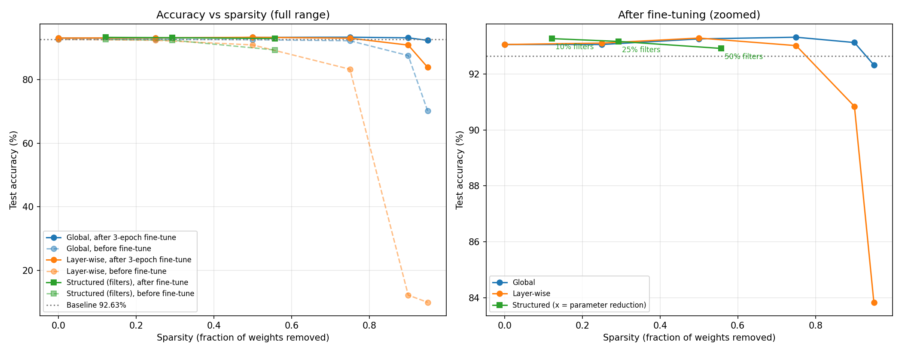
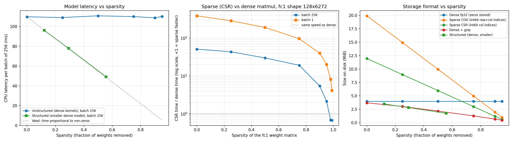
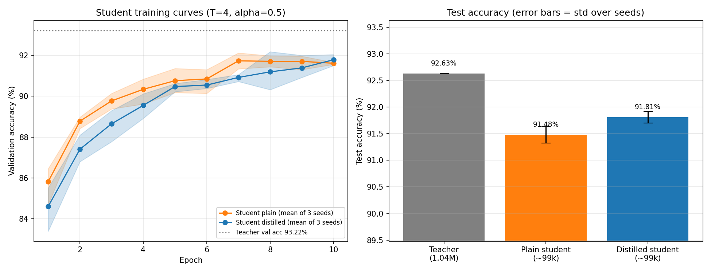
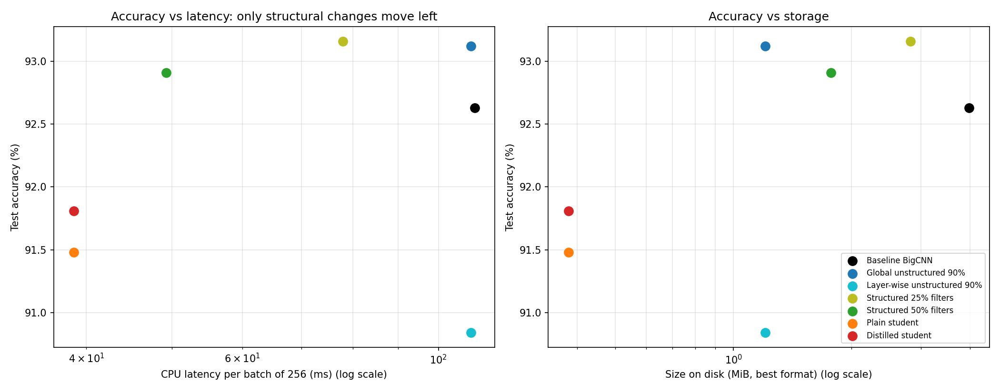

# Lab 7: Compression: Pruning and Distillation

## 1. Goal
The goal of this lab is to compress an oversized CNN for Fashion-MNIST in two ways and to measure honestly what each one buys. Pruning removes weights from a trained model, either one weight at a time (unstructured: global and layer-wise) or whole filters at a time (structured). Knowledge distillation trains a separate small model to imitate the large one. All models are compared on accuracy, parameters, size on disk, compute (MACs) and real CPU latency, and the results are summarised by the four efficiency pillars of Reddi Ch. 9 (data, model, compute, energy). The central question is the difference between a model that is *smaller on paper* and a model that is *actually faster on hardware*.

## 2. Method
- **Data** (`src/common.py`): Fashion-MNIST with the same normalisation (mean 0.2860, std 0.3530) and 55k/5k train/validation split as Labs 3 and 6. Following the Lab 6 profiling result (data loading was 45% of an epoch), the dataset is pre-processed once into tensors in memory and batches are sliced from them. Accuracy is always measured on the 10,000-image test set.
- **Baseline / teacher** (`src/task1_baseline.py`): `BigCNN` = conv(1→32) → conv(32→64) → pool → conv(64→128) → conv(128→128) → pool → fc(6272→128) → dropout 0.25 → fc(128→10), **1,044,490 parameters**, trained for 8 epochs with Adam (lr = 0.001, batch 128).
- **Unstructured magnitude pruning** (`src/task2_pruning.py`): Conv and linear weights are ranked by |w| and the smallest are masked with `torch.nn.utils.prune` (biases, 0.2% of parameters, are not pruned). *Global* uses one threshold over all layers; *layer-wise* prunes every layer to the same sparsity. The targets are [0, 0.25, 0.5, 0.75, 0.9, 0.95]. Each pruned model is fine-tuned for 3 epochs (Adam, lr = 0.0005) with the mask fixed: the layer computes `weight = weight_orig * mask` in every forward pass, so pruned weights get zero gradient and stay zero. The 0% run is a control that gets the same 3 extra epochs.
- **Structured pruning** (`src/task2_pruning.py`): In each of the four conv layers, the 10%, 25% or 50% of output filters with the smallest L2 norm are removed. The matching input channels of the next conv and the matching input columns of fc1 are removed too, and a genuinely smaller dense `BigCNN` is rebuilt (checked: removing 0% gives bit-identical outputs). It is then fine-tuned for 3 epochs like the unstructured models.
- **Latency and storage** (`src/task3_latency_storage.py`): CPU latency (Apple M1, 8 cores, 8 PyTorch threads, PyTorch 2.3.1) is the median of 500 timed forward passes at batch 1 and 40 at batch 256, after warm-up, in `inference_mode`. Batch 1 is also measured with one thread. Size is the `torch.save` file of the state dict, stored as dense fp32, sparse COO, sparse CSR, or dense + gzip. A micro-benchmark compares dense `torch.mm` with CSR `torch.sparse.mm` for a matrix with fc1's shape (128 × 6272) at sparsities from 0 to 0.99.
- **Distillation** (`src/task4_distillation.py`): The teacher is the Task 1 baseline. The student is `SmallCNN` = conv(1→16) → conv(16→32) → pool → conv(32→64) → pool → fc(3136→24) → fc(24→10), **98,834 parameters**. The loss is `alpha * CE(student, labels) + (1 - alpha) * T^2 * KL` with T = 4 and alpha = 0.5. The KL term is implemented as `F.kl_div(log_softmax(s/T), softmax(t/T))`, which is KL(p_teacher ‖ q_student). This is the standard Hinton et al. direction; the manual writes the arguments in PyTorch's call order. The teacher is frozen and there is no augmentation, so its logits are computed once. Plain and distilled students are trained for 10 epochs (Adam, lr = 0.001) with seeds 0, 1 and 2, with the same initial weights and the same data order for each seed. The only difference between them is the loss.
- **Summary** (`src/task5_summary.py`): One table organised by efficiency pillar. Energy could not be metered (macOS `powermetrics` needs root), so it is given as two clearly labelled estimates: (a) measured CPU time per image × an *assumed* 15 W package power; (b) MACs × 4.6 pJ (Horowitz 2014, 45 nm fp32 multiply + add). Estimate (b) covers arithmetic only and ignores memory traffic.
- **Hardware**: Training ran on the Apple GPU (MPS) only to save time. **Every latency number was measured on the CPU.** Seed 42 unless stated. Checkpoints are written to `lab07/checkpoints/` and are not committed; they are recreated by running the scripts in order (task1 → task5).

## 3. Results

**Task 1: Oversized baseline** (`results/task1_baseline.txt`):
| Parameters | Size (fp32) | MACs / image | Test acc | CPU latency b1 | CPU latency b256 |
| :---: | :---: | :---: | :---: | :---: | :---: |
| 1,044,490 | 3.99 MiB | 58.8 M | **92.63%** | 0.70 ms | 110 ms (0.43 ms/image) |

fc1 holds 802,944 of the parameters (77%), but the conv layers do 98.6% of the MACs: conv4 alone does 28.9 M of them.

**Task 2: Magnitude pruning, 3-epoch fine-tune with fixed masks** (`results/task2_pruning.txt`, `results/sparsity_curves.png`):

| Sparsity | Global: before FT | Global: after FT | Layer-wise: before FT | Layer-wise: after FT |
| :---: | :---: | :---: | :---: | :---: |
| 0 (control) | 92.63% | 93.05% | 92.63% | 93.05% |
| 0.25 | 92.65% | 93.05% | 92.35% | 93.10% |
| 0.50 | 92.52% | 93.25% | 90.89% | 93.28% |
| 0.75 | 92.20% | **93.31%** | 83.25% | 93.01% |
| 0.90 | 87.55% | 93.12% | 12.27% | 90.84% |
| 0.95 | 70.15% | 92.32% | 10.00% | 83.84% |

| Structured (filters removed per conv) | Channels | Params (reduction) | MACs | Before FT | After FT |
| :---: | :---: | :---: | :---: | :---: | :---: |
| 10% | (29, 58, 115, 115) | 917,469 (12.2%) | 47.9 M | 92.62% | 93.26% |
| 25% | (24, 48, 96, 96) | 738,794 (29.3%) | 33.3 M | 92.38% | 93.16% |
| 50% | (16, 32, 64, 64) | 463,050 (55.7%) | 15.0 M | 89.31% | 92.91% |

Per-layer sparsity chosen by global pruning at 90%: conv1 17%, conv2 71%, conv3 80%, conv4 83%, fc1 93%, fc2 64%.

**Task 3: Latency and on-disk size** (`results/task3_latency_storage.txt`, `results/latency_storage.png`):

| Model | Non-zero MACs | b1 (ms) | b1, 1 thread (ms) | b256 (ms) | Speed-up b256 | Dense | CSR | gzip |
| :--- | :---: | :---: | :---: | :---: | :---: | :---: | :---: | :---: |
| Unstructured 0% | 58.8 M | 0.70 | 0.96 | 109.9 | 1.00x | 3.99 MiB | 11.96 MiB | 3.71 MiB |
| Unstructured 50% | 44.3 M | 0.66 | 0.96 | 110.9 | 0.99x | 3.99 MiB | 5.99 MiB | 2.17 MiB |
| Unstructured 75% | 26.3 M | 0.73 | 0.96 | 110.1 | 1.00x | 3.99 MiB | 3.00 MiB | 1.27 MiB |
| Unstructured 90% | 12.3 M | 0.66 | 0.97 | 108.8 | 1.01x | 3.99 MiB | 1.21 MiB | 0.68 MiB |
| Unstructured 95% | 6.8 M | 0.89 | 0.99 | 110.2 | 1.00x | 3.99 MiB | 0.61 MiB | 0.46 MiB |
| Structured 10% | 47.9 M | 0.64 | 0.92 | 96.2 | 1.14x | 3.50 MiB | – | 3.25 MiB |
| Structured 25% | 33.3 M | 0.58 | 0.74 | 78.0 | 1.41x | 2.82 MiB | – | 2.62 MiB |
| Structured 50% | 15.0 M | 0.35 | 0.50 | 49.2 | **2.23x** | 1.77 MiB | – | 1.65 MiB |

Sparse COO files are 5x the dense size at 0% sparsity and are still 2.00 MiB at 90%. The batch-1 times move by about ±0.15 ms between identical runs, because a 0.7 ms call is dominated by thread wake-up and Python overhead; the batch-256 and single-thread columns are the reliable ones.

Kernel micro-benchmark, fc1 shape (CSR time / dense time, >1 = sparse slower):
| Sparsity | 0 | 0.5 | 0.75 | 0.9 | 0.95 | 0.98 | 0.99 |
| :--- | :---: | :---: | :---: | :---: | :---: | :---: | :---: |
| Batch 256 | 50.7x | 29.7x | 19.1x | 5.4x | 2.2x | **0.69x** | **0.68x** |
| Batch 1 | 384x | 189x | 96x | 40x | 20x | 8.1x | 4.1x |

**Task 4: Distillation, T = 4, alpha = 0.5, 10 epochs** (`results/task4_distillation.txt`, `results/distillation.png`):

| Seed | Plain student | Distilled student | Difference |
| :---: | :---: | :---: | :---: |
| 0 | 91.36% | 91.75% | +0.39 |
| 1 | 91.66% | 91.94% | +0.28 |
| 2 | 91.42% | 91.74% | +0.32 |
| **Mean ± std** | **91.48 ± 0.16%** | **91.81 ± 0.11%** | **+0.33** |

| Model | Params | Size | MACs | b1 (ms) | b256 (ms) | Test acc |
| :--- | :---: | :---: | :---: | :---: | :---: | :---: |
| Teacher (BigCNN) | 1,044,490 | 3.99 MiB | 58.8 M | 0.75 | 111.1 | 92.63% |
| Plain student | 98,834 | 0.38 MiB | 7.4 M | 0.30 | 38.7 | 91.48% |
| Distilled student | 98,834 | 0.38 MiB | 7.4 M | 0.30 | 38.7 | 91.81% |

The teacher's average top-class probability falls from 0.959 at T = 1 to 0.755 at T = 4, so the softened targets carry real information about the other classes.

**Task 5: Summary by efficiency pillar** (`results/task5_summary.txt`, `results/efficiency_summary.png`):

| Model | **Data**: samples processed | **Data**: labels | **Model**: test acc | **Model**: non-zero params | **Model**: size (best format) | **Compute**: dense MACs | **Compute**: CPU b256 | **Energy** (est.): mJ/image CPU | **Energy** (est.): µJ/image MAC |
| :--- | :---: | :---: | :---: | :---: | :---: | :---: | :---: | :---: | :---: |
| Baseline BigCNN | 440k | hard | 92.63% | 1,044,490 | 3.99 MiB | 58.8 M | 109.9 ms | 6.44 | 270.6 |
| Global unstructured 90% | 605k | hard | 93.12% | 104,890 | 1.21 MiB (CSR), 0.68 gzip | 58.8 M (12.3 M non-zero) | 108.8 ms | 6.38 | 270.6 |
| Layer-wise unstructured 90% | 605k | hard | 90.84% | 104,891 | 1.21 MiB (CSR) | 58.8 M (5.9 M non-zero) | 108.8 ms | 6.38 | 270.6 |
| Structured 25% filters | 605k | hard | 93.16% | 738,794 | 2.82 MiB | 33.3 M | 78.0 ms | 4.57 | 153.1 |
| Structured 50% filters | 605k | hard | 92.91% | 463,050 | 1.77 MiB | 15.0 M | 49.2 ms | 2.88 | 68.8 |
| Plain student | 550k | hard | 91.48% | 98,834 | 0.38 MiB | 7.4 M | 38.7 ms | 2.27 | 34.1 |
| Distilled student | 990k | hard + teacher soft | 91.81% | 98,834 | 0.38 MiB | 7.4 M | 38.7 ms | 2.27 | 34.1 |

Data: samples processed = all training needed to produce the model (the pruned models include the 8 baseline epochs, and the distilled student includes the teacher's training). Energy: estimates, not measurements (see Method).

## 4. Conclusions
1. **The baseline is heavily over-parameterised, and global pruning shows it.** After a 3-epoch fine-tune, global pruning keeps accuracy at or above the baseline up to 90% sparsity (93.12% with 104,890 non-zero weights vs 92.63% dense) and loses only 0.31 points at 95%. Part of every "gain" is simply 3 more epochs of training: the 0% control also rises to 93.05%. The fair comparison is therefore with the control, and against it global pruning is neutral up to 90% (+0.07 points) and costs 0.73 points at 95%.
2. **Global pruning beats layer-wise pruning at high sparsity, because layers are not equally redundant.** Global pruning chose to prune fc1 to 93% but conv1 only to 17% at 90% overall sparsity. Layer-wise pruning forces conv1 (only 288 weights) and fc2 to 90%, which destroys the network before fine-tuning (12.27% at 90%, 10.00% = chance at 95%). Fine-tuning cannot fully recover it (90.84% and 83.84%). The gap only appears above 75% sparsity; below that both methods are equivalent.
3. **Unstructured sparsity reduces storage but not latency.** Batch-256 latency stayed at 108.8–110.9 ms from 0% to 95% sparsity, even though the non-zero MACs fell from 58.8 M to 6.8 M. PyTorch's conv and matmul kernels are dense: they load and multiply the zeros exactly like any other value. A sparse kernel would have to (a) store an index for every non-zero (CSR uses 8-byte int64 indices for 4-byte values, so CSR is 3x larger than dense at 0% and only beats dense above about 67% sparsity), (b) gather inputs at irregular addresses, which breaks SIMD vectorisation, cache blocking and prefetching, and (c) do this for a small matrix where the dense BLAS call is already near peak. In the micro-benchmark, CSR was 50x slower than dense at 0%, 5.4x slower at 90%, and only faster (0.68x) at 98–99% sparsity with batch 256; at batch 1 it was slower at every sparsity. For convolutions PyTorch has no CPU sparse kernel at all. The storage savings are real, but they come from compression (gzip: 3.99 → 0.68 MiB at 90%) or sparse formats, and the weights are decompressed back to dense before inference.
4. **Structured pruning is the only kind of pruning that gave a real speed-up.** Removing whole filters keeps the model dense, just narrower, so the same fast kernels do less work: 50% of filters removed gives 2.23x lower batch-256 latency, 3.9x fewer MACs and 2.3x fewer parameters, at 92.91% accuracy (−0.14 points vs the 0% control). Removing 50% of the filters cuts the MACs to a quarter because each conv loses half its outputs *and* half its inputs. The speed-up (2.23x) is less than 3.9x because pooling, memory traffic and per-layer overhead do not shrink. In the latency plot, the structured points lie close to the "proportional to parameters" line, but this is a coincidence of the two effects, not a rule. The price is a coarser trade-off: at the same parameter count, unstructured pruning is more accurate.
5. **Distillation gives a small but consistent gain at zero inference cost.** With the same architecture, initial weights and data order, the distilled student beat the plain student on all three seeds (+0.39, +0.28, +0.32 points; mean 91.81% vs 91.48%). The gain is about twice the seed-to-seed spread, so it is real. Two costs follow. The distilled student learns more slowly in the first epochs: the soft-target term pulls it towards the teacher's full output distribution, not just the right class, and it only overtakes the plain student at epoch 10. It also needs a trained teacher (in data-pillar terms, 990k samples processed instead of 550k). Inference is identical, so the gain is free at deployment time. The student is still 0.82 points below the teacher, because 99k parameters is roughly a 10x capacity cut.
6. **Pillar summary.** *Model*: unstructured pruning and the student both reach about 100k effective parameters, but only the student also stores and runs as a 100k model (0.38 MiB dense, no special format). *Compute*: what counts is dense MACs actually executed, not non-zeros. The student (7.4 M MACs, 2.84x faster) and structured pruning (15.0 M MACs, 2.23x faster) reduce them; unstructured pruning does not (1.01x). *Energy*: on a dense CPU, energy follows executed time, so the estimated per-image energy falls 2.84x for the student, 2.23x for structured 50%, and essentially not at all for 90% unstructured sparsity. *Data*: compression costs extra training (fine-tuning epochs, or a teacher to distil from), but every method reused the same 55k labelled images and needed no new data. **For deployment on a CPU, I would choose the structured-50% model when accuracy matters most (92.91%, 2.2x faster) and the distilled student when latency, memory and energy matter most (91.81%, 2.8x faster, 10.5x smaller). Unstructured pruning is only worth it for storage or transmission, or on hardware with real sparse support (e.g. 2:4 sparse tensor cores).**
